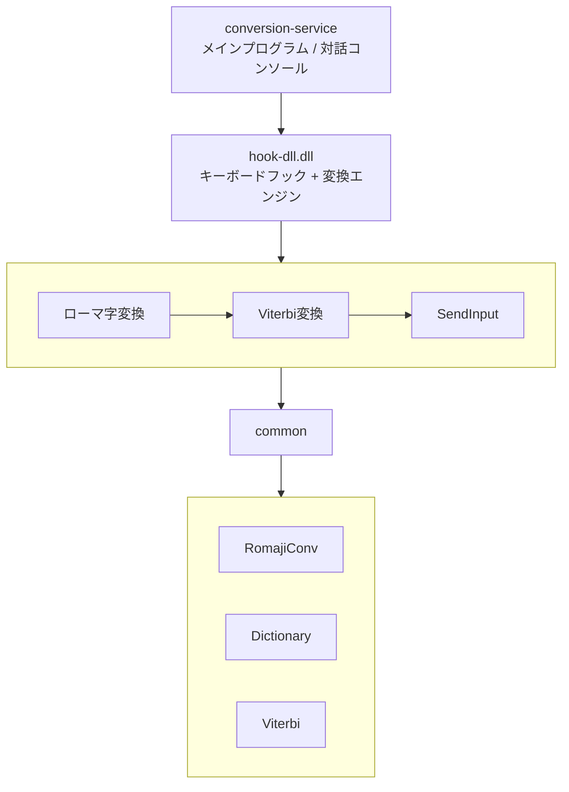

# IME Live Converter

**ライブ変換を核にした、Windows 向けの日本語入力効率化ツール**

打った端から漢字かな交じり文になるライブ変換（macOS 風）を中心に、
「変換を直す」「確定し直す」「次の入力欄へ移る」といった、文字を入力する作業の
前後にある手間もまとめて減らします。すべてローカルで動き、入力した文章を
外部へ送ることはありません。

全キー入力を受け取る常駐フックと、UI Automation による画面上の入力欄の把握を
土台にしているため、変換以外の操作もアプリを問わず同じキーで使えます。
何を作り何を作らないか（対象範囲）、安全面の原則、名前を変えていない理由は
[docs/scope-and-principles.md](docs/scope-and-principles.md) にまとめています。

## 何ができるか

機能は「変換そのもの」「確定の前後の操作」「入力欄まわりの操作」の3層に
分かれます。キー操作の一覧は下の「[使い方](#使い方)」を参照してください。

### 1. 変換（中核）

- **ライブ変換**: Tab やスペースを押さずに、打鍵中のローマ字がリアルタイムで漢字かな交じり文になる
  - ローマ字→ひらがな→漢字を Viterbi（辞書コスト＋接続コスト）で探索
  - **判断層**（任意）: 日本語 Wikipedia で学習した統計言語モデルが、文脈を見て候補を選び直す（下の「判断層」）
  - **続けて打った文節は確定扱い**: 文節（「今日は」「学校に」のように助詞・助動詞・句読点で区切れるまとまり）を打ち終えて次の文節まで打つと、その前の文節を固定する（例: 「今日は学校に」まで打った時点で「今日は」を固定）。固定した部分は後から書き換わらず、Backspace で末尾を消しても変換し直されない（固定した部分そのものを消すと、その分の固定は外れる）。打っている途中の文節とその直前の文節は、後に続く文脈で選び直せるよう固定しない。内容語（名詞・動詞など）を含まない文節は固定しない（打ち途中の一瞬だけ現れる誤った区切りを固定しないため）。長文（読み24文字以上）では、これとは別に末尾12文字を残して先頭側を固定する。固定した文節も確定時の学習には含まれる
  - **変換中の下線**: 直近に変換された単語（後ろに付いた助詞・助動詞を含む。例「学校に」）と打ちかけのローマ字に、黄色のマーカー風の下線を重ねて表示する。候補一覧（Tab）を開いているときは選び直している語に引く。長い線で文章が読みにくくならないよう、変換中の文字列全体には引かない。UI Automation で文字の位置が取れるアプリ（Chrome・Edge・メモ帳・Windows Terminal 等）で表示され、取れないアプリでは出ない。無効化は環境変数 `IME_UNDERLINE=0`
- **学習**: 確定した変換を SQLite（`%LOCALAPPDATA%\IMELiveConverter\ime-learning.db`）に記録し、使うほど自分向けになる。誤学習は候補一覧の **Delete** で1件ずつ取り消せる
- **英単語の自動判定**: 半角/全角を切り替えずに英単語をスペルのまま打てる。`konocodewosyuuseisuru` → `このcodeを修正する`、`githubnipushsuru` → `githubにpushする`。打鍵どおりの英字を英単語の候補にして、判断層が日本語の読み（こで）と同じ物差しで比べる。`madeiku` → `まで行く`、`kitekudasai` → `来てください` のように日本語として自然な読みは日本語のまま。続けた英単語は空白で区切る（`pullrequest` → `pull request`）。Shift で打った大文字に続けても判定する（`D`+`ocker` → `Docker`）。固有名詞・略語は文中のどこでも正しい表記にする（`github` → `GitHub`、`json` → `JSON`。`english_tech.txt` に書いた表記）。文頭（入力欄の先頭・。！？・改行の直後）から英単語だけを打ったときは頭文字を大文字にする（`hello` → `Hello`。「meetingは」のように日本語が混ざる入力や、`kubectl` 等の用語はそのまま）。外れたときは **Tab** の候補一覧で英字⇔日本語を選び直せる。英単語は `dictionaries/english_words.tsv`（頻度表）と `dictionaries/english_tech.txt`（IT用語）。無効化は環境変数 `IME_ENGLISH=0`
- **周りの文章を文脈に使う**: 入力欄のカーソルより前の文章（最大300文字）の名詞を、同音異義語の選び分けに使う。パスワード欄・管理者権限のアプリ・ターミナルでは読まない。読んだ文章は保存しない
- **単語登録**: 辞書に無い複合語（例「思い出の品」）を「読み→表記」で登録（日本語変換モードで `Ctrl+Alt+A`）。ライブ変換器の辞書へ即注入され、次の変換から候補に出る
- **括弧の種類切替**: `[` `]` は 「 」 になり、直後に **Tab** で 『』【】（）〈〉《》〔〕［］｛｝ に切り替えられる。閉じ括弧 `]` は直前のまだ閉じていない開き括弧に自動で対応する（入れ子も可）。「かっこ」「すみつきかっこ」などの読みからも括弧ペアを候補に出せる（`dictionaries/extra.csv`）

#### 入力中の文章修正（もしかして）

自動変換に失敗したときや、限定した定型の誤記に限って、修正候補を「もしかして」として
先頭に出します。正しく変換できている入力には出しません。

- **ローマ字取り残し**: 英字が残って変換できないケース（例: `gmennasai`→`ごめんなさい`、`saynara`→`さよなら`）。母音抜け・打ちすぎ・転置・末尾nをカバー
- **定型の誤記**: 挨拶・依頼文などの限定した誤記（例: `おねがいしまうす` → `おねがいします`、文頭の `わたしわ` → `わたしは`）。同じ入力内の複数の該当箇所はまとめて修正し、修正した読みは通常の辞書で漢字変換する
- **学習済みの誤変換**: `Ctrl+Alt+R` や候補一覧での選び直しで記録した「誤った表記→正しい表記」の組を、次に同じ誤変換が出たときに出す
- 候補は全文ではなく変更箇所（`会社 → 学校`）を表示する。元の表記に文字を足すだけの補完や、定型句の続きを追記する予測は出さない。異なる表記の候補が僅差の場合は提案を見送る
- 表示中は Enter だけで先頭の修正候補を採用する。↑/↓ や番号キーでも選べる。採用した修正は学習し、候補の Delete で取り消せる
- 未確定のローマ字がある間や Esc でかなに戻した部分には、新しい規則補正を出さない

対象は入力中の未確定テキスト（規則補正は128文字まで）です。確定済み文書の
書き換え、事実誤認の訂正、意味全体を判断する校正には対応していません。

### 2. 確定の前後の操作

- **確定後の復元**: 確定した直後に **変換キー** を押すと、直前の確定の別候補を一覧で出し、選び直して置き換えられる（Space/↓/変換キーで次、↑で前、数字で直接、Enter で置換、Esc でそのまま）。カーソル移動・クリック・フォーカス移動・貼り付けの後は、誤って別の場所を書き換えないよう使えなくなる
- **句読点で変換を変えない確定**: 句読点は読みに入れて変換し直さず、表示中の変換をそのまま確定して後ろに「、」「。」を足す
- **誤変換の記録**: `Ctrl+Alt+R` で誤変換を記録する。候補一覧や復元で選び直したときは自動で記録し、次回「もしかして」で正しい表記を出す（記録先 `%LOCALAPPDATA%\IMELiveConverter\misconversion_reports.tsv`）
- **前方一致の予測補完**: 過去に確定した内容に前方一致する語を、候補一覧が閉じている状態で **Tab** を押すと表示する。通常の入力中は自動では出さない
- **候補一覧のページング**: 同音異義語は1ページ9件で固定表示。9件を超えると自動でページが切り替わり、位置（例 12/23）を表示する
- **F6〜F10**: 入力中の文字を ひらがな／カタカナ／全角英数／半角英数 に変換して確定（MS-IME と同じ割り当て）
- **カーソル移動**: 変換中でも ←→ で1文字移動、素早く2回で行端（Home/End）

### 3. 入力欄まわりの操作

- **入力欄ワープ**: `Ctrl+無変換` で画面上の次の入力欄へ、`Ctrl+Shift+無変換` で前の入力欄へフォーカスを移す。前面のウィンドウだけでなく、並べて表示している他のウィンドウの欄も対象（ウィンドウ単位で左→右、ウィンドウ内は上→下）。Windows Terminal の分割ペインや VS Code の統合ターミナルも1つの欄として数える。移った先の欄の位置に「入力欄 2/5」のように表示する
- **環境ごとのモード**: ウィンドウ（ターミナル等）ごとに日本語入力/コマンドモードを独立して記憶する
- **コマンドモード（ターミナル）**: Windows Terminal / PowerShell / cmd / Git Bash / VS Code 統合ターミナルで、よく使うコマンドを提案する。Tab で選択、Enter で実行、Delete で履歴削除。`gs`→`git status` のようなエイリアスも登録できる（設定ウィンドウで管理）
- **ポップアップ外クリックで閉じる**: 候補・予測・コマンド候補のポップアップは、外側をクリックすると閉じる。下書き中ならクリック時点の表示で確定する（一般的な IME と同じ）

### 安全のための自動停止

次の場所では変換もキーの横取りもせず、キーをそのままアプリへ渡します。

- **パスワード欄**: UI Automation と Win32 のスタイルの両方で判定する。フォーカスが動いてから判定が付くまでの間も、「安全」とは見なさず素通しにする
- **管理者権限のアプリ**（本ツールより権限が高いウィンドウ）: Windows の制限で変換結果を送れず、キーが消えてしまうため
- **MS-IME との競合**: MS-IME が開いていると二重に変換されるので、環境の切り替え時などに閉じる
- **緊急 OFF**: `Ctrl+Space` で全機能を止める／戻す（画面に「変換 OFF/ON」と出る）
- 二重起動を防止する（多重フックによる二重入力を回避）

## アーキテクチャ



## インストール（配布版、Rust 不要）

1. [Releases](https://github.com/takamurayuki/ime-live-converter/releases) から
   `IMELiveConverter-<版>-x64.zip` をダウンロードして展開
2. 展開したフォルダで次を実行（管理者権限の確認が出たら「はい」）

```powershell
powershell -ExecutionPolicy Bypass -File install.ps1
```

- 更新も同じ手順です（学習データは残ります）。辞書・判断層モデル（約370MB）は
  初回とモデル更新時だけ自動でダウンロードされます。
- プログラム: `%LOCALAPPDATA%\Programs\IMELiveConverter`、
  学習データ・ログ: `%LOCALAPPDATA%\IMELiveConverter`
- アンインストール: `%LOCALAPPDATA%\Programs\IMELiveConverter\uninstall.ps1`
- 版の付け方・配布の仕組みとその判断理由: [docs/release-and-versioning.md](docs/release-and-versioning.md)

## ビルド

```bash
cargo build --release
```

## 辞書の準備

本格的な漢字変換には辞書が必要です。IPA辞書（MeCab用）を使用できます。

### 1. IPA辞書のダウンロード

```bash
# 安定ミラー（Debian）からダウンロード
curl -L -o mecab-ipadic.tar.gz \
  "http://deb.debian.org/debian/pool/main/m/mecab-ipadic/mecab-ipadic_2.7.0-20070801+main.orig.tar.gz"

tar xzf mecab-ipadic.tar.gz
```

### 2. バイナリ辞書の生成

```bash
# dict-builder を使って辞書を生成（約39万語、-r/--release 推奨）
cargo run --release -p dict-builder --bin dict-builder -- \
  build ./mecab-ipadic-2.7.0-20070801 ./dictionaries/system.dic
```

`dictionaries/system.dic` があれば CLI 起動時に自動でロードされます
（なければ `dictionaries/sample.dic` にフォールバック）。

### 3. 判断層（judge-lm、任意）

文脈を見て自動変換の結果を選び直す統計言語モデルです。日本語 Wikipedia で
学習した単語トライグラム＋文法クラスモデル（IPADic の品詞・活用形）で、
ラティス全体から「LM の確率＋辞書コスト＋個人学習」が最大の経路を選びます。
計算は決定論的でローカル完結です（外部通信なし）。

`dictionaries/judge_lm.bin` があれば起動時に自動で読み込まれ（フック常駐時は
バックグラウンドで読み込み、終わるまでは従来の変換で動きます）、無ければ
従来の変換とまったく同じ動作です。

```bash
# 1. 素材: Wikipedia ダンプ（約4.7GB）と vibrato 用 IPADic モデル
curl -L -o jawiki.xml.bz2 https://dumps.wikimedia.org/jawiki/latest/jawiki-latest-pages-articles.xml.bz2
curl -L https://github.com/daac-tools/vibrato/releases/download/v0.5.0/ipadic-mecab-2_7_0.tar.xz | tar xJ

# 2. 本文の文を抽出（展開律速、全量で約45分）
cargo run --release -p dict-builder -- wiki-extract jawiki.xml.bz2 jawiki.txt

# 3. 学習（IPA辞書ディレクトリは「辞書の準備」で展開したもの）
cargo run --release -p dict-builder -- judge-train \
  ipadic-mecab-2_7_0/system.dic.zst ./mecab-ipadic-2.7.0-20070801 \
  jawiki.txt ./dictionaries/judge_lm.bin judge_dev.tsv

# 4. 評価とパラメータの書き込み（従来エンジンとの正解率比較）
JUDGE_SCALE=2000 JUDGE_UNK=-2 cargo run --release -p common --example judge_eval -- \
  ./dictionaries/judge_lm.bin judge_dev.tsv 3000 --write
```

dict-builder は既定で CPU の約半分（作業スレッド＝論理コア数の半分）を使い、
プロセス優先度を「通常以下」に下げて動きます（他のアプリの操作を妨げないため）。
急ぐときは `DICT_BUILDER_THREADS=<数>`（作業スレッド数）や
`DICT_BUILDER_PRIORITY=normal`（優先度を下げない）で変えられます。

共起モデル（任意、`dictionaries/judge_cooc.bin`）は文中・直前の確定文の名詞どうしの
結びつきで同音異義語を選び分けます:

```bash
cargo run --release -p dict-builder -- judge-cooc   ipadic-mecab-2_7_0/system.dic.zst ./mecab-ipadic-2.7.0-20070801 ./dictionaries/system.dic   jawiki.txt ./dictionaries/judge_cooc.bin judge_cooc_dev.tsv
```

**無効化（元に戻す）**: 環境変数 `IME_JUDGE=0` で起動するか、
`dictionaries/judge_lm.bin` を削除/リネームしてください。共起だけ止めるなら
`IME_JUDGE_COOC=0` か `dictionaries/judge_cooc.bin` の削除/リネームです。調査用に
`examples/judge_show`（候補ごとの内訳）・`judge_bench`（打鍵ごとの時間）があります。

## 使い方

### CLI の起動

```bash
cargo run --release -p ime-cli
```

起動すると辞書がロードされます（学習DBは既定で一時DB。実運用の学習DBを使うには `--learning` で指定）。

### ライブ変換モード（おすすめ）

プロンプトで `:live` と打つとライブ変換モードに入ります。
ローマ字をそのまま打つと、入力停止（250ms）や句読点・「です/ます」などの
文節境界で自動的に仮変換されます。

| キー | 動作 |
|------|------|
| Space | 仮変換の実行 / 次候補 |
| Shift+Space | 前候補 |
| Enter | 確定（学習に記録） |
| Esc | 仮変換をキャンセルしてひらがなに戻す |
| Backspace | 1文字削除（Ctrl+Backspace で全消し） |
| Ctrl+C | ライブモード終了 |

### 全アプリ版（conversion-service）のキー操作

**日本語入力モード**（半角/全角キーで ON）:

| キー | 動作 |
|------|------|
| **Tab** / ↓ | 通常変換（同音候補一覧を開く・次候補）。候補が9件を超えると**自動でページが切り替わり**、全候補を巡回できます |
| ↑ / Shift+Tab | 前候補 |
| 数字 1〜9 | 一覧・予測から番号で直接選択・確定（**各ページの1〜9**。ページ送りで全候補を番号選択可） |
| **Delete** | 候補一覧・**予測一覧**で選択中の変換の**誤学習をリセット**（過去に誤確定して上位に居座った変換や、誤って学習された予測補完を、その1件だけ取り消す。同じ読みの他の学習は残る） |
| **Space** | 現在の変換を確定して空白を入れる（非変換中は通常の空白）。英単語は自動で英字のまま確定される（上の「英単語の自動判定」。Enter も同じ） |
| **F6 / F7 / F9 / F10** | 入力中の文字を ひらがな／カタカナ／全角英数／半角英数（打ったまま）に変換して確定（MS-IME と同じ割り当て。英単語の自動判定が日本語を選んだとき、入力全体を英字にする逃げ道） |
| **← / →** | カーソルを1文字移動（変換中は確定してから移動）。**素早く2回で行端**（←=Home / →=End） |
| Backspace | 直近の変換単語（文節）ごと削除 |
| **Esc** | 末尾から一文節ずつひらがなに戻す（押すたびに前へ）。戻すものが無ければ取消 |
| Enter / 句読点 | 確定（学習に記録）。予測/もしかして表示中は選択中の候補を確定。句読点は読みに入れて変換し直さず、表示中の変換をそのまま確定して後ろに「、」「。」を足す |
| 半角/全角 | 日本語入力 ⇔ 英数（コマンドモード）を切替（**環境ごとに独立**） |
| カタカナ/ひらがな | 日本語入力に切替（MS-IME には渡さない。MS-IME が開いて二重に変換されるのを防ぐ） |
| **Ctrl+Alt+R** | **誤変換を記録**（変換中ならその変換、そうでなければ直前の確定）。変換中に候補一覧で別の候補に直して確定したとき・確定後の復元で選び直したときは、誤った表記と正しい表記の組を自動で記録し、次に同じ読みで同じ誤変換が出たら「もしかして: 正しい表記」を出す（不要なら一覧で選んで Delete）。記録先は `%LOCALAPPDATA%\IMELiveConverter\misconversion_reports.tsv` |
| **変換キー** | **確定後の復元**: 直前の確定の別候補を一覧で出す。続けて変換キー/Space/↓で次、↑で前、数字で直接、Enter で置き換え、Esc でそのまま |
| **Ctrl+無変換** / **Ctrl+Shift+無変換** | **入力欄ワープ**: 画面に見えている次の／前の入力欄へフォーカスを移す（並べた他のウィンドウ・ターミナルの分割ペインも対象） |
| Ctrl+Space | 変換機能の緊急ON/OFF |
| **Ctrl+Alt+A** | 設定を開く（**モードで出し分け**）。日本語変換モード → **単語登録**ウィンドウ／コマンドモード → **コマンド設定**ウィンドウ |

- **もしかして**は、ローマ字が取り残されて自動変換に失敗した時だけ「もしかして: ◯◯」と先頭に出ます。↑↓/番号で選び Enter で確定します（正しく変換できている入力には出ません）。
- **誤変換レポート**の確認（開発用）: `cargo test -p hook-dll triage_misconversion_reports -- --ignored --nocapture` で、記録した各読みを今のエンジンで変換し直し「直った／未解決」と `regressions.tsv` に貼れる行を表示します。
- **周りの文章を文脈に使う**: 日本語入力中、入力欄のカーソルより前の文章（最大300文字）を読み、その中の名詞を同音異義語の選び分け（判断層の共起）に使います。パスワード欄・管理者権限のアプリ・ターミナルでは読みません。読んだ文章は保存しません。
- **単語登録**（日本語変換モードで `Ctrl+Alt+A`）: 辞書に無い複合語（例「思い出の品」）を「読み → 表記」で登録できます。登録した語は `user_dictionary`（DB）に保存され、ライブ変換器の辞書へ即反映されます（次の変換から候補に出ます）。一覧から選んで削除も可能です。

### コマンドモード（ターミナル）

ターミナル（Windows Terminal / PowerShell / cmd / Git Bash / VSCode統合ターミナル）に
フォーカスがあり、日本語入力OFF（半角/全角で切替）のとき自動でコマンドモードになります。
打ったコマンドを学習し、次回から前方一致で候補を出します。

| キー | 動作 |
|------|------|
| （入力） | 打鍵に応じてコマンド候補ポップアップを表示（**先頭が選択状態**） |
| **Tab / Shift+Tab** | 候補一覧の選択（ハイライト）を上下に移動（挿入・実行はしない） |
| **Enter** | 選択中の候補を挿入＆実行（エイリアスは展開。`auto_run` オフのものは挿入のみで編集可） |
| **Delete** | 選択中が**コマンド履歴**なら、その履歴を学習DBから削除して一覧から消す（エイリアスは対象外。設定ウィンドウで管理） |
| ↑ / ↓ | シェルの履歴呼び出し（触りません） |
| Esc | 候補を閉じる |
| ⚙ 設定（ポップアップ右上） | 設定ウィンドウを開く |

- 別のターミナル/ウィンドウへ移って戻ると、**カーソルが戻った時点で**その環境の入力内容が
  復元され候補ポップアップが自動で再表示されます（打鍵を待ちません）。
- ポップアップの見出しに、選択中候補の Enter の挙動（**Enter:即実行** / **Enter:挿入のみ**）が
  表示されます（設定ウィンドウの「Enterで即実行」チェックと連動。Tab で候補を移動すると
  その候補の挙動に切り替わります）。

### コマンド/エイリアスの設定（設定ウィンドウ）

`Ctrl+Alt+A` またはコマンドポップアップ右上の **⚙ 設定** で開きます。

- **登録内容**: エイリアス名 / コマンド・スクリプト（「参照...」でスクリプトファイルを選択可）/ 説明 を入力して「新規/更新」。
  - エイリアス名を空にすると「コマンド」（履歴コマンドの説明編集用）として登録。
  - **「Enterで即実行」チェック**: オンならコマンドモードでの Enter で即実行、オフなら挿入のみ（`git commit -m ""` のように編集してから実行するコマンド用）。
- **一覧テーブル**: エイリアス / コマンド / 説明 / **Enter**（即実行 / ✎挿入のみ）の列。列見出しクリックで名前順ソート（▲▼表示）。行をクリックでフォームに反映（チェックボックスにも反映）、下部の詳細欄に全文表示。
  - 検索・並び替え・登録後も編集中の行の選択は維持され、チェックボックスの表示と一覧の Enter 列が常に同じ項目を指します（登録後に続けて別の項目を入力するときは「クリア」）。
- **検索** で絞り込み、**並び替え**ボタンで 作成順 ⇔ 使用頻度順、**表示**ドロップダウンで すべて/エイリアス/コマンド を切替。

## 常時バックグラウンドで起動する

キーボードフックはユーザーセッションで動く必要があるため、Windows サービス
ではなく **ログオン時に常駐**させます。`--background` を付けると標準入力を
読まずに常駐します（対話コマンドは使えません）。

### 自動起動を登録（推奨: 非表示・ログオン時）

```powershell
# 先にビルドしておく
cargo build --release

# 管理者権限の PowerShell で登録（次回ログオンから非表示で自動起動）
powershell -ExecutionPolicy Bypass -File scripts\install-autostart.ps1

# 今すぐ開始する場合
Start-ScheduledTask -TaskName IMELiveConverter
```

- 黒いコンソールは出ません（`scripts\run-hidden.vbs` 経由で非表示起動）。
- 最上位の権限で動くので、管理者権限のアプリ上でも変換が効きます。
- **停止/解除**: `powershell -ExecutionPolicy Bypass -File scripts\uninstall-autostart.ps1`
- 一時的に手動で試すだけなら: `wscript scripts\run-hidden.vbs`（停止はタスクマネージャーで `conversion-service.exe` を終了）

### 学習がおかしくなったら（誤変換の学習を掃除）

誤変換のまま確定を続けると、その誤りを学習して悪化することがあります
（再汚染を防ぐガードは入っていますが、過去の汚染は下記で掃除できます）。

**その場で1件だけ消す**: 変換中に **Tab** で候補一覧を開く（または予測一覧が
出ている状態で）、誤学習された変換を選んで **Delete** を押すと、その (読み→表記)
の学習だけをその場でリセットできます（DBの確定履歴・バイグラムとメモリ上の学習の
両方から消え、同じ読みの他の正しい学習は残ります）。「誤って確定した内容がそのまま
予測に出てくる」ケースもこれで消せます。日常的な誤学習はこれが一番手軽です。

**まとめて掃除する**（大きく汚染された場合）:

```powershell
python scripts\clean-learning-db.py            # 掃除
python scripts\clean-learning-db.py --dry-run  # 何が消えるか確認だけ
```

> **誤字補正について**: 以前は Shift+Space でローカルLLM校正を行っていましたが、
> CPU実行では速度・精度の費用対効果が低かったため**廃止**しました。代わりに、
> ローマ字が取り残されて自動変換に失敗した時だけ即時に働く「もしかして」補正
> （辞書＋ローマ字編集の探索。LLM不要）に置き換えています。

### 行単位モード（検証用）

プロンプトにそのまま入力すると変換候補一覧が表示されます。

| コマンド | 説明 |
|----------|------|
| `:live` | ライブ変換モード |
| `:commit <N>` | N番目の候補を確定して履歴学習 |
| `:user add <読み> <表記>` | ユーザー辞書に登録 |
| `:typo <入力>` | 誤字補正候補のみ表示 |
| `:nbest <入力> [N]` | Viterbi N-best のみ表示 |
| `:help` / `:quit` | ヘルプ / 終了 |

## 開発

- 対象範囲・安全面の原則・新しい機能を足すときの判断基準: [docs/scope-and-principles.md](docs/scope-and-principles.md)
- 配布・バージョン管理の方針（版の上げ方、ファイルの置き場所、リリース手順）とその判断理由: [docs/release-and-versioning.md](docs/release-and-versioning.md)
- 初期の要件定義（変換エンジン中心だった頃のもの。現状との差分は冒頭に記載）: [requirements.md](requirements.md)

### プロジェクト構造

```
crates/
├── common/              # 変換エンジン（層1）。OS に依存しない
│   ├── dictionary.rs    #   辞書データ構造
│   ├── viterbi.rs       #   Viterbi 変換
│   ├── judge*.rs        #   判断層（統計言語モデル・共起）
│   ├── english.rs       #   英単語の自動判定
│   ├── typo.rs          #   もしかして
│   ├── learning.rs      #   学習 DB
│   └── conversion.rs    #   入力状態（確定後の復元のリングバッファ等、層2）
├── hook-dll/            # 常駐フック。Windows 依存の部分（層2・層3）
│   ├── hook.rs          #   キー入力の振り分け・ホットキー
│   ├── uia.rs           #   UI Automation（入力欄の位置、パスワード欄等の判定）
│   ├── field_jump.rs    #   入力欄ワープ
│   ├── command_mode.rs  #   ターミナルのコマンドモード
│   └── popup.rs         #   候補ウィンドウ・表示
├── conversion-service/  # 常駐プログラム本体（hook-dll を読み込む）
├── cli/                 # 対話 CLI（変換の検証用）
└── dict-builder/        # 辞書・判断層モデルのビルダー
```

### テスト

```powershell
powershell -ExecutionPolicy Bypass -File scripts
un-tests.ps1
```

（`cargo test --workspace` を実行します。crate を指定して手で打つと検査漏れが出たことが
あるため、このスクリプトを使ってください）

## 制限事項

- ローマ字入力（US配列想定）が対象。JIS配列だと一部の記号がずれます。
- ターミナル等はIMEの未確定文字列を持てないため、ライブ変換は Backspace+文字挿入で
  再現しています（描画の遅い環境では稀に乱れることがあります）。
- コマンドモードの打鍵追跡は「観測」ベースのため、貼り付けやシェル補完で挿入された
  文字は追跡できません（矢印での行編集時は候補追跡をリセットします）。
- VSCode等の統合ターミナル判定は UI Automation（フォーカス要素のクラス名/名前）に
  依存するため、環境によっては検出できないことがあります。
- 入力欄ワープは UI Automation で入力欄を見つけるため、欄を公開していないアプリ
  （独自描画のゲーム等）では見つかりません。Windows Terminal では表示中のタブの
  ペインだけが対象です。ブラウザの読み取り専用のページ本文は欄として数えません。
- 一部のアプリケーションでは動作しない可能性があります。

## ライセンス

- プログラム本体: MIT License
- 辞書 `system.dic`: IPA 辞書由来（[packaging/licenses/IPADIC-COPYING.txt](packaging/licenses/IPADIC-COPYING.txt)）
- 判断層モデル `judge_lm.bin` / `judge_cooc.bin`: 日本語 Wikipedia（Wikipedia の寄稿者）の
  本文から作った統計データで、[CC BY-SA 4.0](https://creativecommons.org/licenses/by-sa/4.0/) で配布
  （[packaging/licenses/NOTICE.txt](packaging/licenses/NOTICE.txt)）。継承（SA）の条件は
  モデルのファイルにだけかかり、それを読むプログラム本体には及びません

## 参考

- [MeCab](https://taku910.github.io/mecab/) - 形態素解析エンジン
- [IPA辞書](https://taku910.github.io/mecab/#download) - 辞書データ
